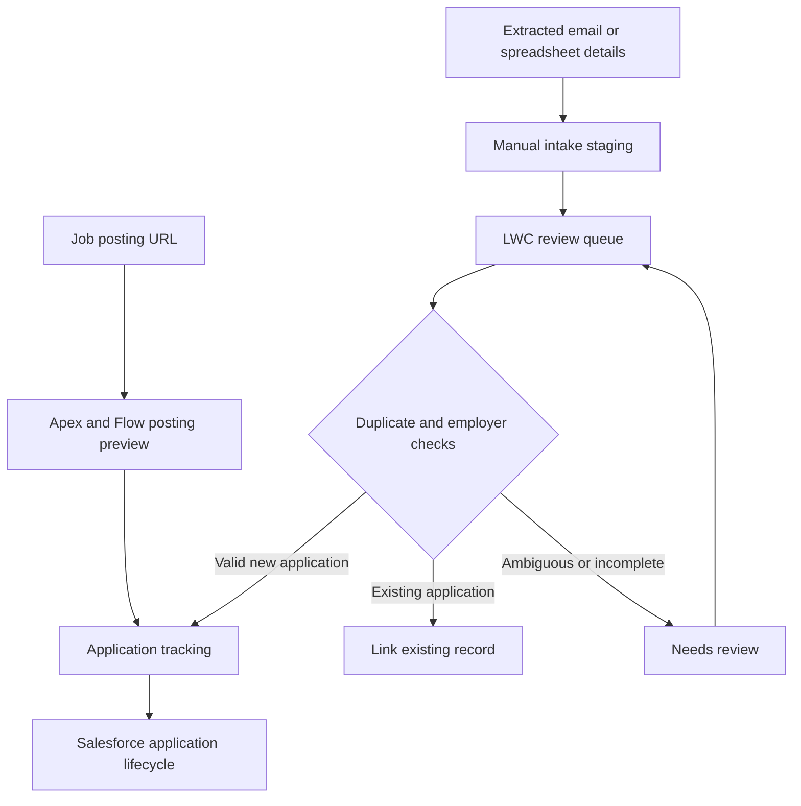

# Career Hub | Salesforce & AI Portfolio Project

Career Hub is a Salesforce-based job application management project that applies CRM architecture, revenue operations principles and human-in-the-loop automation to the recruitment journey. It is designed to demonstrate practical Salesforce administration, development, integration and solution design skills.

## Business problem

Job applications, employer details and recruitment updates often live across job boards, email and spreadsheets. Career Hub centralizes application tracking, improves data consistency and provides a structured review process before new records enter the CRM.

## Capabilities

| Capability | Implementation |
| --- | --- |
| Application lifecycle | Salesforce custom objects, fields, relationships and declarative automation |
| Employer management | Account-based employer records and matching |
| Job posting intake | Apex and Flow-based URL preview and import capabilities |
| Application review | Lightning Web Component queue with explicit reviewer approval |
| Duplicate prevention | Unique source keys and conservative employer/title matching |
| Integration design | Job posting APIs and Salesforce Named/External Credentials |
| AI-assisted intake | Agentforce development on a separate feature branch |
| Quality assurance | Apex test classes and documented synthetic UAT scenarios |

## Architecture



The diagram describes the logical application architecture, not an automated mailbox connection. The main-branch intake queue accepts manually staged details and does not read Gmail, store email bodies or connect directly to Google Sheets.

## Technology stack

- Salesforce Platform: custom objects, validation rules, permission sets and Flow
- Apex: business logic, integration services and unit tests
- Lightning Web Components: interactive application review
- REST APIs: job posting retrieval and preview
- Named Credentials and External Credentials: external authentication configuration
- Agentforce: AI-assisted intake development (feature branch)
- Salesforce CLI, Git and GitHub: source control and deployment

## Human-in-the-loop intake

The intake queue requires a reviewer to select **Check and Import** before creating an application. Duplicate records are linked rather than overwritten. Missing or ambiguous employers and incomplete or later-stage source records are held for review. The current queue creates new applications at the Applied stage only.

See the [application intake documentation](salesforce/docs/application-intake-queue.md) for the process diagram, source-key conventions, deployment instructions and seven manual acceptance test scenarios.

## Agentforce development

The [Agentforce intake feature branch](https://github.com/carvalhoclint/career-hub/tree/codex/career-hub-intake-agent) contains agent configuration, Apex actions and tests for AI-assisted application intake. This work is separate from the main-branch baseline; it should not be interpreted as a completed production deployment.

## Security and privacy

- Credential references are used for external authentication rather than embedding API keys in source code.
- The intake object is private and reviewer access is controlled through a dedicated permission set.
- Repository-wide ignore rules exclude common credential files, local authentication caches and private data exports.
- GitHub Secret Protection, push protection and dependency security settings have been enabled.
- A Gitleaks scan on November 25, 2026 reported zero findings across 26 commits in the then-current mirrored history. This is a point-in-time check, not a guarantee of security.
- Use synthetic data for demonstrations. Never commit real application records, email contents or credentials.

## Getting started

Prerequisites: a Salesforce development org, Salesforce CLI and Git. Clone the repository and authenticate to your own development org:

```bash
git clone https://github.com/carvalhoclint/career-hub.git
cd career-hub/salesforce
sf org login web --alias career-hub-dev
```

Review the metadata and dependencies before deploying. For the intake module, validate using the documented manifest:

```bash
sf project deploy start --dry-run --target-org career-hub-dev \
  --manifest manifest/career-hub-intake.xml \
  --test-level RunSpecifiedTests --tests CareerHubApplicationIntakeTest --wait 10
```

After successful validation, follow the intake documentation for deployment and reviewer permission assignment. Configure any external credentials separately in your own org. Do not deploy to production without reviewing dependencies and access requirements.

## Roadmap

- Extend and validate AI-assisted intake and review workflows.
- Connect external ingestion processes to the intake queue.
- Expand application pipeline analytics and reporting.
- Add automated security and code-quality checks.
- Publish synthetic-data screenshots and a demonstration walkthrough.

## Portfolio focus

This project demonstrates CRM data modeling, declarative automation, Apex development, API integration, AI-assisted workflows, data governance, least-privilege access and structured testing. It is a personal learning and portfolio project under active development.
