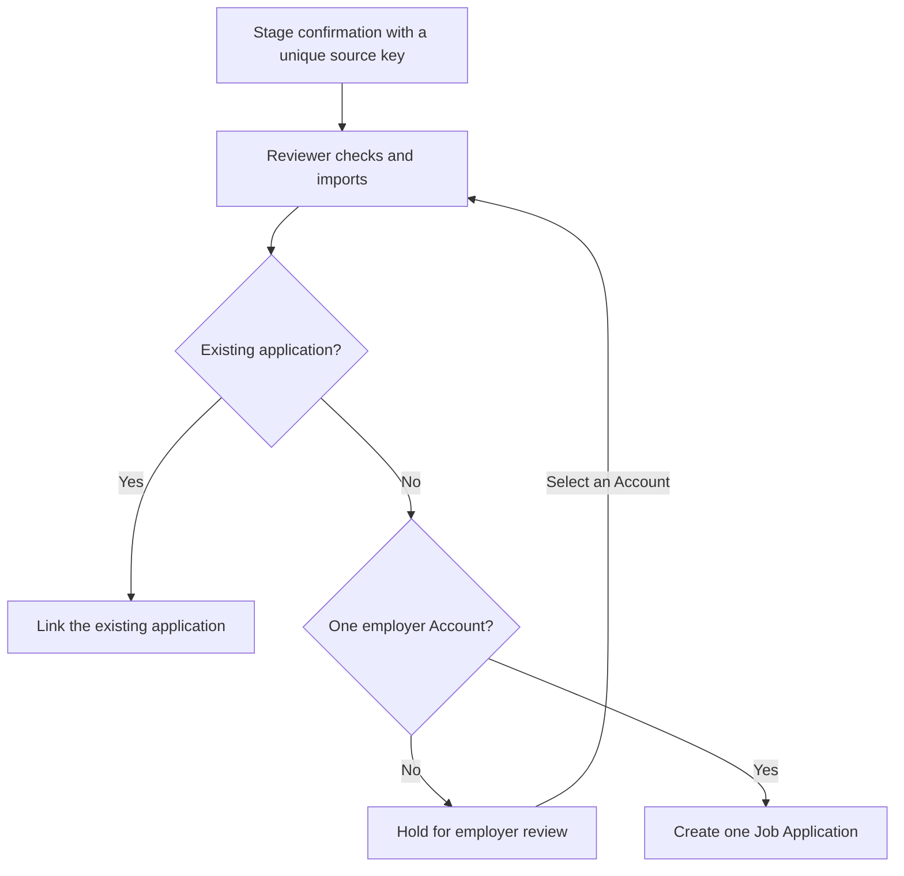

# Application Intake Queue

The queue stages extracted application details from Gmail or a spreadsheet for review. It does not read a mailbox or store email bodies. The reviewer chooses **Check and Import** before a Job Application can be created.



Duplicate checks use the `gmail:` key from the earlier backfill, or a spreadsheet key, then the resolved employer and exact job title. Several applications with the same employer and title are held for review. A reviewer must create a missing employer Account outside the queue or select an existing one. Existing applications are never updated. The employer and title check is conservative: different requisitions with identical titles may be treated as duplicates. The custom object is private; the permission set grants access to the tab, service, and required records and fields without granting View All.

## Validate and demonstrate

From the Salesforce project directory, validate against the dev org:

```bash
sf project deploy start --dry-run --target-org career-hub-dev \
  --manifest manifest/career-hub-intake.xml \
  --test-level RunSpecifiedTests --tests CareerHubApplicationIntakeTest --wait 10
```

After validation, rerun without `--dry-run` to deploy. Assign the **Career Hub Intake Reviewer** permission set to the intended reviewer, then open **Application Intake Queue** from Career Hub.

### Manual acceptance test cases

**Prerequisites:** Deploy to `career-hub-dev`, assign **Career Hub Intake Reviewer**, then open **Career Hub → Application Intake Queue**. Create a synthetic Account named **CH UAT Pipeline Co**. Use a fresh set of synthetic keys and titles on subsequent runs. Enter **September 1, 2026** for any case that calls for a known past date. Leave **Employer Account override** blank unless specified. No Gmail or Google Sheets connection is needed.

To stage a row, enter **Source Record Key**, **Employer Name from Email**, **Job Title**, **Stage in Source**, and **Applied Date**, then click **Stage Confirmation**. A new item starts in the open queue. To process it, click **Review → Check and Import**. Turn on **Show completed items** to see **Imported** and **Duplicate** records and open the linked Job Application.

| ID | Scenario and steps | Expected result |
| --- | --- | --- |
| UAT-01 | Stage `gmail:b200000000000001`, **CH UAT Pipeline Co**, **CH UAT Revenue Systems Analyst**, **Applied**, and the known date. Review it. | The intake appears as **Imported** in completed items. **Open Application** opens a single Job Application with that title, employer, date, and **Applied** stage. Save its record ID for UAT-03. |
| UAT-02 | Try to stage the exact same source key from UAT-01 again. | Salesforce shows a duplicate-value error. No second intake or application is created. |
| UAT-03 | Stage `gmail:b200000000000002` with the same employer, job title, stage, and date as UAT-01. Review it. | The intake is **Duplicate**. **Open Application** opens the same record ID from UAT-01. The existing application is unchanged and there is still only one application for that employer and title. |
| UAT-04 | Stage `sheet:aaaaaaaaaaaaaaaaaaaaaaaaaaaaaaaaaaaaaaaaaaaaaaaaaaaaaaaaaaaaaaaa`, **CH UAT Pipeline Co**, **CH UAT Spreadsheet Analyst**, **Applied**, and leave **Applied Date** blank. Review it. After checking the result, enter the known date under **Save Source Details**, save, and review again. | The first attempt stays **Needs Review** in the open queue and creates no application. After the date is saved and the item is reviewed again, it becomes **Imported** and links to one application with the supplied date. |
| UAT-05 | Stage `sheet:bbbbbbbbbbbbbbbbbbbbbbbbbbbbbbbbbbbbbbbbbbbbbbbbbbbbbbbbbbbbbbbb`, **CH UAT Pipeline Co**, **CH UAT Historical Analyst**, **Later Stage**, and the known date. Review it. | The intake stays **Needs Review** and creates no Job Application. A historical row is never automatically reset to **Applied**. |
| UAT-06 | Create two Accounts named **CH UAT Shared Employer** if the org allows duplicate Account names. Stage `gmail:b200000000000003` for that employer, **CH UAT GTM Systems Analyst**, **Applied**, and the known date. Review once with no override. Then select the intended Account and review again. | The first review stays **Needs Review** with an explanation about multiple matches and creates no application. The second review creates one application linked to the specific Account you selected. If Account duplicate rules prevent setup, mark this case **Blocked** and run UAT-07. |
| UAT-07 | Stage `gmail:b200000000000004`, employer **CH UAT No Matching Employer** (do not create that Account), **CH UAT Business Systems Analyst**, **Applied**, and the known date. Review with no override. Then select **CH UAT Pipeline Co** and review again. | The first review stays **Needs Review** without creating an application. The second review imports one application under **CH UAT Pipeline Co**. |

Record **Pass**, **Fail**, or **Blocked** for each case, with the intake number and the linked application ID when applicable. UAT-04 and UAT-05 reproduce spreadsheet data quality issues using synthetic values. The placeholder spreadsheet keys above exercise the input format; use real stable digests for actual spreadsheet ingestion.

The queue is a manual intake MVP; it does not connect to Gmail or Google Sheets. A future ingestion integration can stage the same intake fields through Salesforce without changing the review and approval logic.

## Spreadsheet input

Use a `sheet:` key followed by a lowercase SHA-256 digest of a stable source identifier. Prefer an immutable application ID; if the source has no such column, derive the identifier consistently from a source namespace and normalized employer, title, and application date. Do not hash the row number alone. Changes to natural-key fields may change the digest, so check employer and title during review.

The current queue only creates new records at **Applied**. Map explicit later outcomes to **Later Stage**, and blank or unmapped statuses to **Unknown**. Leave partial dates blank instead of guessing a year. These cases stay in **Needs Review**, even if an employer is unambiguous. Historical status migration is a separate operation. Use **Save Source Details** to correct a verified date or status, then review the intake again.
