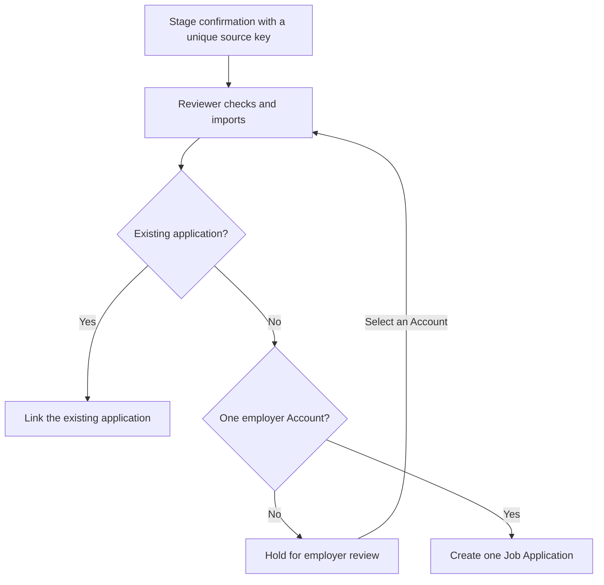

# Application Intake Queue

The queue stages extracted application details from Gmail or a spreadsheet for review. It does not read a mailbox or store email bodies. The reviewer chooses **Check and Import** before a Job Application can be created.



Duplicate checks use the `gmail:` key from the earlier backfill, or a spreadsheet key, then the resolved employer and exact job title. Several applications with the same employer and title are held for review. A reviewer must create a missing employer Account outside the queue or select an existing one. Existing applications are never updated. The employer and title check is conservative: different requisitions with identical titles may be treated as duplicates. The custom object is private; the permission set grants access to the tab, service, and required records and fields without granting View All.

## Validate and demonstrate

From the Salesforce project directory, validate against the dev org:

```bash
sf project deploy start --dry-run --target-org career-hub-dev \
  --manifest manifest/career-hub-intake.xml \
  --test-level RunSpecifiedTests --tests CareerHubApplicationIntakeTest --wait 10
```

After validation, rerun without `--dry-run` to deploy. Assign the **Career Hub Intake Reviewer** permission set to the intended reviewer, then open **Application Intake Queue** from Career Hub.

Use synthetic values, select **Applied** as the source stage, and choose a past Applied Date:

| Case | Input | Expected result |
| --- | --- | --- |
| Clean | Create Account **Demo Pipeline Co**. Stage source key **gmail:a100000000000001**, that employer, and role **Revenue Systems Analyst**. Click **Review**, then **Check and Import**. | The completed view shows one **Imported** intake with a working application link. |
| Replay | Stage the same Gmail source key again. Then use **gmail:a100000000000002** with the original employer and title and review it. | The repeated ID cannot be staged. The second message links to the existing application with **Duplicate** status. |
| Ambiguous employer | Create two Accounts named **Demo Shared Employer**, if org duplicate rules allow it. Stage **gmail:a100000000000003** with that name and role **GTM Systems Analyst**. | The intake stays in **Needs Review** without creating an application. Select the intended Account and retry; one record is created. |
| Missing employer | Stage **gmail:a100000000000004** against a name with no matching Account. | The intake stays in **Needs Review** until an Account is selected. |

The queue is a manual intake MVP; it does not connect to Gmail or Google Sheets. A future ingestion integration can stage the same intake fields through Salesforce without changing the review and approval logic.

## Spreadsheet input

Use a `sheet:` key followed by a lowercase SHA-256 digest of a stable source identifier. Prefer an immutable application ID; if the source has no such column, derive the identifier consistently from a source namespace and normalized employer, title, and application date. Do not hash the row number alone. Changes to natural-key fields may change the digest, so check employer and title during review.

The current queue only creates new records at **Applied**. Map explicit later outcomes to **Later Stage**, and blank or unmapped statuses to **Unknown**. Leave partial dates blank instead of guessing a year. These cases stay in **Needs Review**, even if an employer is unambiguous. Historical status migration is a separate operation. Use **Save Source Details** to correct a verified date or status, then review the intake again.
